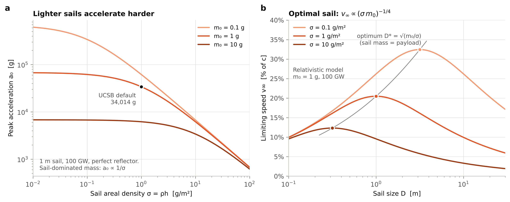
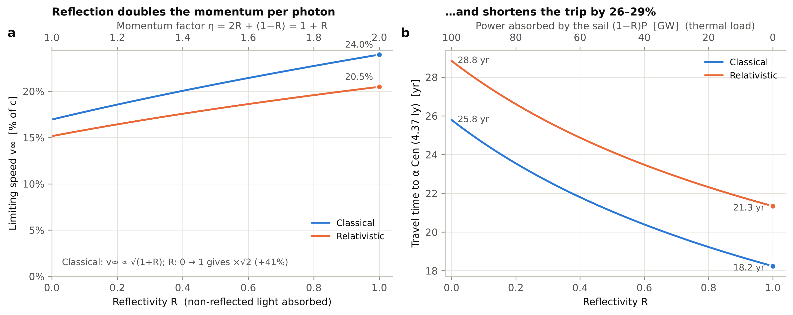
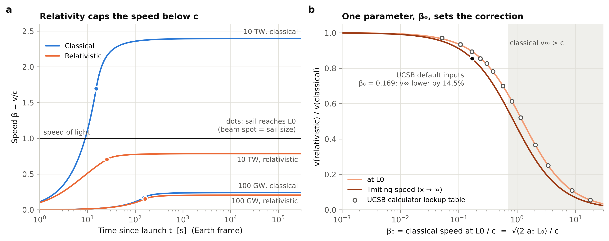
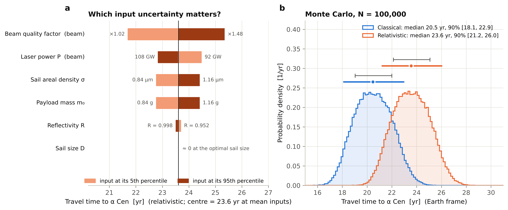

# Lightsail Simulation

Computational modeling of photon-propelled lightsail dynamics: an interactive, real-time simulation of laser-driven lightsails, classical vs relativistic, based on the UCSB 1-D laser propulsion model (P. Lubin, *A Roadmap to Interstellar Flight*, 2016).

**Live simulation:** <https://rainnreinmiller.github.io/lightsail-sim/> · **Report:** [report/report.pdf](report/report.pdf) ([Markdown](report/REPORT.md))

> **Research question.** How do the physical properties of a lightsail affect its predicted acceleration, velocity and interstellar travel time?
>
> * How does sail mass per unit area affect acceleration?
> * How does reflectivity affect momentum transfer?
> * How does the predicted motion change between classical and relativistic models?
> * How does uncertainty in physical parameters affect the predicted results?

The scope is idealized spacecraft motion. The laser (power, array size, wavelength) is a fixed, idealized input; laser hardware and beam delivery are not designed or optimized here.

## What's in the repository

| Path | What it is |
|---|---|
| `lightsail/` | Python reference implementation (NumPy, SciPy): parameters, closed-form physics, `solve_ivp` integrator, sensitivity and uncertainty analysis |
| `tests/` | 48 validation tests: UCSB calculator reproduction, closed form vs ODE, physical limits, JS ↔ Python cross-check |
| `scripts/make_figures.py` | Generates the four scientific figures (Matplotlib) and `figures/results.json` |
| `figures/` | Fig. 1–4 as 300-dpi PNG and vector PDF |
| `web/` | The browser simulation: `index.html`, `js/physics.js` (engine), `js/app.js` (UI and animation), `js/charts.js` |
| `report/` | Short report (`REPORT.md` → `report.pdf`) covering assumptions, methods, validation and findings |
| `.github/workflows/pages.yml` | Runs the tests, then deploys the simulation to GitHub Pages |

## The interactive simulation

The simulation is a single static web page with no server.

* **Interactive.** Changing any parameter recomputes both trajectories in about 2 ms. The parameters are sail areal density, reflectivity, absorption, payload, sail size and shape, laser power, array size and shape, wavelength, beam quality, laser-off distance and target.
* **Real-time animation.** A classical sail and a relativistic sail race from Earth to α Centauri on a logarithmic distance track. The track shows landmarks, the distance L₀ where the beam spot outgrows the sail, a diffracting beam cone and a beam-spot inset. Playback options:
  * true real time (×1; the default sail reaches L₀ after 2.7 min)
  * fixed warps up to 10 yr/s
  * automatic log-time mode, which plays the whole 21-year trip in about 40 s
* **Live readouts.** Earth and ship clocks, distance, speed, γ, acceleration felt, beam fraction captured, and the Doppler-shifted laser wavelength.
* **Explore tab.** Live sweeps of limiting speed vs σ, travel time vs R, limiting speed vs P, and β(x).
* **Uncertainty tab.** An in-browser Monte Carlo with an editable uncertainty budget, a tornado chart, variance shares and first-order propagation.
* **Sharing and export.** The *Copy link* button stores the current setup in the URL. Trajectories can be downloaded as CSV.

## Physics in one paragraph

A sail of size D and areal density σ carries payload m₀, so m = σξD² + m₀. Its momentum factor is η = 2R + (1−R)A, giving a peak acceleration a₀ = ηP/(mc). The diffraction-limited spot equals the sail size at L₀ = dD/(2λα); beyond L₀ the sail intercepts a fraction (L₀/x)² of the beam. The two equations of motion are

* classical: dv/dt = a₀f(x)
* relativistic: c·d(γβ)/dt = a₀f(x)·(1−β)/(1+β), where the last factor is the double Doppler penalty

Both have closed forms in terms of the work integral W(x) = ∫f dx:

* classical: v = √(2a₀W), so v∞ = √2·v(L₀)
* relativistic: (𝒟−1)²(𝒟+2) = 6a₀W/c², with Doppler factor 𝒟 = √((1+β)/(1−β))

The relativistic correction depends only on β₀ = √(2a₀L₀)/c. Travel times come from closed forms near the laser plus Gauss–Legendre quadrature, and are checked against direct integration with `scipy.integrate.solve_ivp`.

## Key results (UCSB calculator defaults: 100 GW, 10 km array, 1.06 µm, 1 g payload, 1 g/m² sail)

| | Classical | Relativistic |
|---|---|---|
| Peak acceleration | 34,000 g | 34,000 g |
| Speed at L₀ (3.9 million km) | 16.9 % c after 152 s | 15.1 % c after 161 s |
| Limiting speed | 24.0 % c | 20.5 % c |
| Travel time to α Cen (4.37 ly) | 18.2 yr | 21.3 yr (ship clock 20.9 yr) |
| Monte Carlo travel time, median (90 % interval) | 20.5 yr (18.1–22.9) | 23.6 yr (21.2–26.0) |

* **Areal density.** With the optimal sail (sail mass = payload mass), v∞ ∝ (σ·m₀)^−¼. Going from 10 to 0.1 g/m² raises the relativistic v∞ from 12 % c to 32 % c.
* **Reflectivity.** R = 0 → 1 gains √2 in speed (classical) or ×1.35 (relativistic) and cuts the trip by 26–29 %. Above R ≈ 0.99 the speed barely changes, but the sail temperature falls steeply. Reflectivity then matters for the sail's survival, not its speed.
* **Relativity.** The correction to v∞ is about 1 % at β₀ = 0.01, 9 % at 0.1, 14.5 % for the defaults and 35 % at 0.5. At 10 TW the classical model predicts 2.4c.
* **Uncertainty.** The beam's diffraction factor dominates the variance (64 %). Among the sail properties, areal density and payload mass contribute 12 % each and reflectivity only 0.3 %. Relativity lowers every sensitivity by a factor of about 0.85.
* **Calculator check.** All classical outputs match the UCSB classical calculator exactly, and the relativistic speeds match its lookup tables. The relativistic calculator's *time to L₀* (180 s) is about 12 % longer than direct integration gives (161 s).






## Running it

```bash
pip install -r requirements.txt
```

```bash
python -m pytest
```

The tests need Node.js for the JavaScript cross-check, which runs `web/js/physics.js` on Python-generated cases.

```bash
python scripts/make_figures.py
```

```bash
bash scripts/build_site.sh && python -m http.server -d _site 8000
```

Then open <http://localhost:8000>. To rebuild the report PDF, which needs pandoc and the Playwright Node package:

```bash
node scripts/build_report.cjs
```

Python usage:

```python
from lightsail import baseline, RELATIVISTIC
from lightsail.physics import mission_summary
from lightsail.simulate import simulate

p = baseline().with_(thickness=0.5e-6, reflectivity=0.99)   # 0.5 g/m^2 sail
print(mission_summary(p, RELATIVISTIC))                     # closed form + quadrature
traj = simulate(p, RELATIVISTIC)                            # solve_ivp trajectory
```

## Deployment

Pushing to `main` runs the test suite and deploys the simulation, figures and report to GitHub Pages. Enable Pages once under **Settings → Pages → Source: GitHub Actions**.

## References

1. P. Lubin, “A Roadmap to Interstellar Flight,” *JBIS* 69, 40–72 (2016), arXiv:1604.01356.
2. N. Kulkarni, P. Lubin, Q. Zhang, “Relativistic Spacecraft Propelled by Directed Energy,” *AJ* 155, 155 (2018), arXiv:1710.10732.
3. UCSB Experimental Cosmology Group, Laser Propulsion Classical 1D and Relativistic 1D calculators (deepspace.ucsb.edu).
