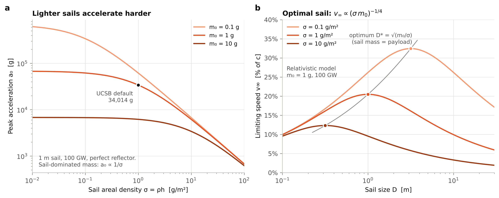
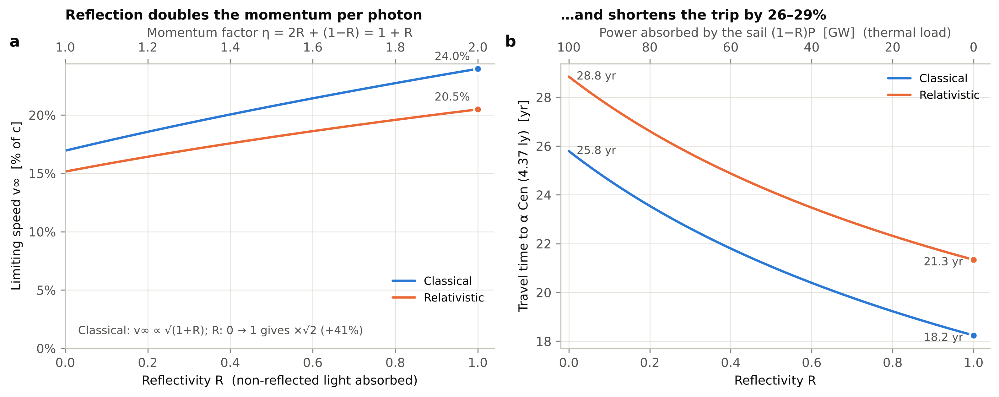
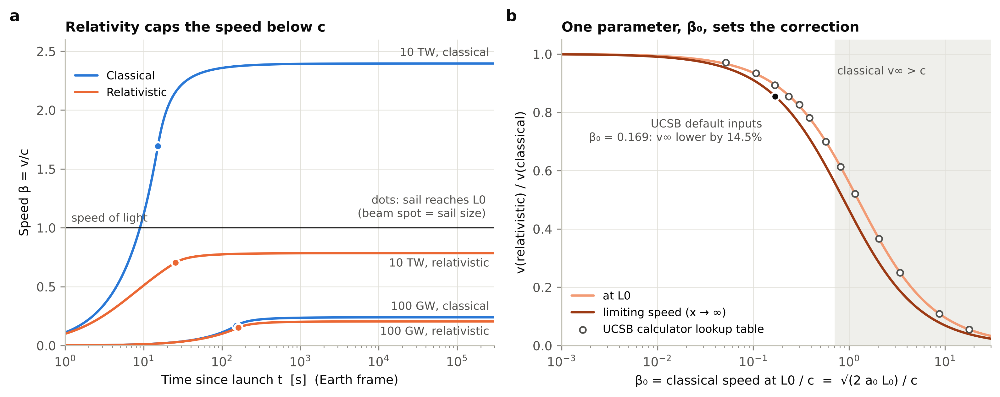

**Prepared for:** Prof. Philip Lubin, UCSB Experimental Cosmology Group

**Code, tests and interactive simulation:** <https://github.com/rainnreinmiller/lightsail-sim> · live demo: <https://rainnreinmiller.github.io/lightsail-sim/>

## Summary

**Research question.** How do the physical properties of a lightsail affect its predicted acceleration, velocity and interstellar travel time? The model follows the 1-D directed-energy propulsion model of Lubin (2016) and Kulkarni, Lubin & Zhang (2018), as implemented in the UCSB *Laser Propulsion* calculators. It is solved three independent ways: closed form, direct ODE integration (SciPy), and a JavaScript port that runs in the browser. All three agree to about 10⁻¹⁰.

Key findings for the UCSB calculator's default inputs (100 GW, 10 km array, 1.06 µm, 1 g payload, 1 g/m² sail):

1. **Areal density σ.** At fixed sail size, peak acceleration falls as $1/(\sigma A + m_0)$. With the optimal sail (sail mass = payload mass), peak acceleration is fixed at 34,000 g. A lighter sail instead buys a larger sail and a longer acceleration distance $L_0$, so the limiting speed scales as $(\sigma m_0)^{-1/4}$. Going from 10 to 0.1 g/m² raises $v_\infty$ from 12.3 % c to 32.4 % c (relativistic).
2. **Reflectivity R.** The momentum per photon is $\eta = 2R + (1-R)A$, so classically $v_\infty \propto \sqrt{1+R}$. A perfect reflector is 41 % faster than a perfect absorber (classical) and 35 % faster (relativistic). That shortens the trip to α Cen from 28.8 to 21.3 yr. Near R = 1, however, speed barely depends on R while the absorbed power, and so the sail temperature, depends on it strongly. Survival, not momentum, sets the reflectivity requirement.
3. **Classical vs relativistic.** The relativistic correction depends on one number, $\beta_0 = \sqrt{2a_0L_0}/c$, the classical speed at $L_0$. For the defaults ($\beta_0 = 0.169$) relativity lowers $v_\infty$ from 24.0 % c to 20.5 % c (−14.5 %) and lengthens the trip from 18.2 to 21.3 yr (+17 %). At 10 TW the classical model predicts 2.4c, while the relativistic one gives 0.78c.
4. **Uncertainty.** Plausible input spreads (Monte Carlo, N = 10⁵) give a relativistic travel time of 23.6 yr (90 % interval 21.2–26.0 yr). The beam's diffraction factor carries 64 % of the variance. Among the sail properties, areal density and payload mass contribute 12 % each and reflectivity only 0.3 %. The sail size has zero sensitivity at the optimum. Relativity *reduces* the sensitivity to every input by a factor of 0.85.
5. **Live data (simulated).** A Bayesian estimator turns a stream of Doppler tracking measurements into a live prediction. The stream is *simulated*, because no laser-driven sail has flown. Its 90 % travel-time interval shrinks from 4.8 yr to 0.15 yr within an hour of launch and to 0.06 yr by the end of the stream. The intervals are calibrated: they contained the hidden truth for 90 of 100 simulated sails. Before the sail passes L₀ the data fix the acceleration but say nothing about L₀, and therefore little about the top speed.
6. **Checks against the calculators and papers.** Our outputs reproduce the UCSB classical calculator exactly and the relativistic calculator's speeds to its table precision. Our equations are those of Lubin (2016) and Kulkarni, Lubin & Zhang (2018), and the model reproduces all 13 mission cases in Tables 1–2 of the 2018 paper. We found one inconsistency: the relativistic calculator's *time to L₀* is 180 s, but direct integration gives 161 s. The 2018 paper's own table supports the integrated value (164 s vs. our 163 s for its 1 g case).

## 1. Model and assumptions

A sail of size $D$ (square, area $\xi D^2$ with $\xi = 1$, or circular with $\xi = \pi/4$) and areal density $\sigma = \rho h$ carries a payload $m_0$. A laser array of size $d$ and power $P$ at wavelength $\lambda$ pushes it. The sail reflects a fraction $R$ of the light and absorbs a fraction $A$ of the remainder:

$$
m = \sigma \xi D^2 + m_0,\qquad \eta = 2R + (1-R)A,\qquad a_0 = \frac{\eta P}{m c},\qquad L_0 = \frac{d\,D}{2\lambda\alpha}.
$$

The diffraction-limited spot grows linearly with distance and equals the sail size at $L_0$. Here $\alpha = 1.22$ for a circular array and 1 for a square one, times an optional beam-quality factor. The fraction of the beam that hits the sail is $f(x) = 1$ for $x \le L_0$, $(L_0/x)^2$ for $L_0 < x \le x_\text{stop}$, and 0 once the laser is switched off. The equations of motion are

$$
\text{classical:}\quad \frac{dv}{dt} = a_0 f(x), \qquad\qquad
\text{relativistic:}\quad c\,\frac{d(\gamma\beta)}{dt} = a_0 f(x)\,\frac{1-\beta}{1+\beta}.
$$

The relativistic factor is the double Doppler shift. In the sail frame each photon's energy and the photon arrival rate are both reduced by $\sqrt{(1-\beta)/(1+\beta)}$. Absorbed energy is assumed to be re-radiated isotropically in the sail frame, so the rest mass is constant and the longitudinal force is frame-invariant.

**Closed forms.** Using the energy theorem $mc^2\,d\gamma = F\,dx$ and the work integral $W(x) = \int_0^x f\,dx'$ ($= x$ inside $L_0$, $2L_0 - L_0^2/x$ beyond),

$$
\text{classical:}\ v = \sqrt{2a_0W}\ \Rightarrow\ v_\infty = \sqrt2\,v(L_0);\qquad
\text{relativistic:}\ (\mathcal D-1)^2(\mathcal D+2) = \frac{6a_0W}{c^2},\quad \mathcal D=\sqrt{\frac{1+\beta}{1-\beta}}.
$$

The relativistic cubic is solved analytically, in a form that keeps full precision when β ≪ 1. Writing $q = 6a_0W/c^2 = 3\beta_0^2\,W/L_0$ shows that the ratio of relativistic to classical speed depends only on $\beta_0$. Inside $L_0$ the Earth time and ship proper time are also closed form: $t = \tfrac{c}{a_0}\tfrac{\mathcal D^3+3\mathcal D-4}{6}$ and $\tau = \tfrac{c}{a_0}\tfrac{\mathcal D^2-1}{2}$. Beyond $L_0$ we use $t = \int dx/v$ and $\tau=\int dx/(\gamma v)$: closed form classically, and Gauss–Legendre quadrature in $\ln x$ relativistically.

**Relation to the papers.** For a perfect reflector ($\eta = 2$), the relativistic equation of motion above is Eq. 10 of Kulkarni, Lubin & Zhang (2018). Their Eq. 11 for the time inside $L_0$, $t = \tfrac{t_\text{rel}}{6}\big[\tfrac{(1+\beta)(2-\beta)\gamma}{1-\beta} - 2\big]$ with $t_\text{rel} = mc^2/P$, is algebraically identical to our $t$ above. Our cubic gives the speed at any distance; at $x = L_0$ it reduces to their Eq. 27. Lubin (2016), Eqs. 22–23, gives an earlier *first-order* relativistic expression for $t(\beta)$ and refers to a more complete solution elsewhere. We use the 2018 solution, which the UCSB relativistic calculator also follows. The two expressions agree to first order in β, but at 0.2c the 2016 expression gives 0.103 $t_E$ against 0.126 $t_E$.

**Assumptions.**

- One-dimensional motion at normal incidence. The sail is flat and rigid and rides the beam stably (no tilt, spin or deformation).
- Constant power, with idealized diffraction: full capture inside $L_0$ and $(L_0/x)^2$ beyond. No atmosphere, pointing jitter or side-lobes.
- The opaque sail ($A = 1$, as in the UCSB defaults) re-radiates absorbed power. Thermal limits are reported but not enforced.
- No gravity, no interstellar drag, no deceleration at the target (flyby).
- The laser stays on until $x_\text{stop}$, which defaults to infinity. Light-travel delay after switch-off is ignored.

The laser is an idealized, fixed input. Hardware design and beam delivery are outside the scope of this study.

**Baseline** (UCSB calculator defaults): P = 100 GW; d = 10 km, circular (α = 1.22); λ = 1060 nm; m₀ = 1 g; h = 1 µm and ρ = 1 g/cm³, so σ = 1 g/m²; optimal square sail, D = 1 m (1 g); R = 1, A = 1; target 4.37 ly (α Cen A/B). The papers' baseline differs slightly: a square array (α = 1), 1064 nm, and ρ = 1.4 g/cm³ (σ = 1.4 g/m²). The simulator offers it as the preset *Kulkarni et al. 2018, Table 1 (1 g)*.

### 1.1 Where the numbers come from

The simulator uses no measured data. Every output is computed from the equations above and the input parameters. The inputs and equations come from the following sources.

| Item | Source | Code |
|---|---|---|
| Default inputs (power, array, wavelength, payload, sail thickness and density, R = A = 1, 4.37 ly target) | UCSB Laser Propulsion calculators (JavaScript source of both pages) | `lightsail/params.py`, `web/js/physics.js` |
| Sail mass ξD²hρ, force (1+ε<sub>r</sub>)P₀/c, generalized to ηP₀/c with η = 2R+(1−R)A as in the calculator; a₀, L₀, t₀, v₀, v∞ = √2·v₀, optimal sail m<sub>sail</sub> = m₀, beam efficiency | Lubin (2016) Eqs. 1–13; UCSB classical calculator | `params.py`, `physics.py` |
| α = 1 (square array) or 1.22 (circular); ξ = 1 or π/4 | Lubin (2016) §2; Kulkarni et al. (2018) Eq. 21 | `constants.py` |
| Beam capture f(x) = (L₀/x)² beyond L₀ | Lubin (2016) §2; Kulkarni et al. (2018) Eqs. 22–23 | `physics.py` |
| Relativistic equation of motion with the (1−β)/(1+β) Doppler factor | Kulkarni et al. (2018) Eq. 10. For R < 1 we scale the force by η/2, treating absorbed light as re-radiated isotropically in the sail frame (our assumption). | `physics.py`, `simulate.py` |
| Closed-form speed at any distance (cubic in 𝒟), ship proper time, far-field quadrature | Derived here. Checked against Kulkarni et al. Eqs. 11 and 27, their Tables 1–2, and the relativistic calculator. | `physics.py` |
| Sail equilibrium temperature | UCSB calculators | `params.py` |
| Uncertainty ranges, beam-quality factor, presets | Our illustrative assumptions | `uncertainty.py`, `web/js/app.js` |
| Proxima Centauri (4.2465 ly), Barnard's Star (5.96 ly), landmark distances, physical constants | Standard reference values | `constants.py` |
| Tracking measurements in §3.5 and the *Live data* tab | **SIMULATED**: this model plus Gaussian noise, for a hidden sail drawn from the uncertainty ranges. No real lightsail tracking data exist. | `telemetry.py`, `web/js/assimilation.js` |

## 2. Numerical methods and validation

| Method | Purpose |
|---|---|
| Closed form (`lightsail/physics.py`, NumPy-vectorized) | speeds, near-field times; fast enough for 10⁵-sample Monte Carlo |
| Gauss–Legendre quadrature in ln x | relativistic far-field time and proper time |
| `scipy.integrate.solve_ivp` (DOP853, rtol 10⁻¹¹, events at L₀, laser-off, target) | independent check by direct integration of the ODE |
| JavaScript port (`web/js/physics.js`) | powers the browser simulation; cross-checked against Python under Node |

The test suite has 91 tests (`pytest`). It verifies the following:

- The closed forms match the ODE to < 10⁻⁸ in β, t, τ and acceleration. The observed error is about 10⁻¹¹.
- The relativistic model reduces to the classical one at low speed and never reaches c.
- $v_\infty = \sqrt2\,v_0$ classically.
- The work–energy theorem holds.
- The optimal sail maximizes $v_\infty$.
- The JS engine matches Python to < 10⁻¹⁰ on 18 random and edge-case parameter sets.
- The model matches the equations of Lubin (2016) and Kulkarni et al. (2018) and reproduces the 2018 paper's Tables 1–2 (`tests/test_papers.py`).
- The live estimator recovers the truth from low-noise data, and its 90 % intervals are calibrated over repeated simulated sails. It matches its JavaScript port to < 10⁻⁶ (`tests/test_assimilation.py`).

**Comparison with the UCSB calculators (default inputs).**

| Quantity | UCSB classical | This work, classical | UCSB relativistic | This work, relativistic |
|---|---|---|---|---|
| Peak acceleration | 34,014 g | 34,014 g | 34,014 g | 34,014 g |
| L₀ | 3.866×10⁹ m | 3.866×10⁹ m | same | same |
| Speed at L₀ | 16.94 % c | 16.94 % c | 15.11 % c (table) | 15.15 % c |
| Time to L₀ | 152.3 s | 152.3 s | **180.1 s** | **161.1 s** (ODE: 161.1 s) |
| Limiting speed | 23.96 % c | 23.96 % c | 20.36 % c (table) | 20.48 % c |
| Time to 4.37 ly | 18.25 yr\* | 18.24 yr | 21.47 yr\* | 21.34 yr (ship: 20.89 yr) |

\*The calculators use a 365-day year and coast-only travel time. The acceleration phase changes the travel time by < 10⁻⁵.

The classical columns agree to machine precision. The relativistic calculator interpolates lookup tables tabulated to about 0.6 %, which explains the 0.3–0.6 % differences in speed. Its limiting-speed relation, $\tfrac{(2-4\beta_0)\sqrt{1-\beta_0^2}}{3(1-\beta_0)^2} - \tfrac13 = \tfrac13 - G(\beta_\infty)$, is algebraically identical to our cubic with $W = 2L_0$ (tested to 10⁻¹²).

Its time-to-L₀ expression is not. The calculator evaluates Kulkarni et al.'s Eq. 11, but obtains $t_\text{rel} = mc^2/P$ from the classical time to L₀ as $2t_0/\beta$. It uses the relativistic β there instead of the classical $\beta_0$. The result is our integrated time multiplied by $\beta_\text{cl}/\beta_\text{rel}$, which is 12 % too long at these inputs and more at higher β₀. The paper's own Table 1 confirms the integrated value: for its 1 g case it lists $t_0$ = 164 s. Our integration gives 163 s, while the calculator's expression would give 183 s.

**Comparison with Kulkarni, Lubin & Zhang (2018), Tables 1–2.** Their inputs are 100 GW, a 10 km square array, 1064 nm, ρ = 1.4 g/cm³ and an optimal square sail. Representative rows:

| Sail, payload | t₀: paper / ours | β at L₀: paper / ours | β_max: paper / ours |
|---|---|---|---|
| 1 µm, 1 g | 164 s / 163 s | 0.15 / 0.153 | 0.21 / 0.207 |
| 1 µm, 10 g | 901 s / 896 s | 0.091 / 0.0906 | 0.13 / 0.125 |
| 1 µm, 1 kg | 2.79×10⁴ s / 2.77×10⁴ s | 0.030 / 0.0299 | 0.042 / 0.0420 |
| 0.1 µm, 1 g | 306 s / 304 s | 0.25 / 0.250 | 0.33 / 0.328 |
| 0.01 µm, 1 g | 587 s / 584 s | 0.39 / 0.386 | 0.48 / 0.482 |

All 13 rows agree closely. Our times are 0.3–0.8 % shorter, which matches the paper having used rounded sail sizes: with D = 0.85 m in place of 0.845 m, our 1 g value becomes 164 s. Sail sizes and L₀ agree within 3.5 %, β at L₀ within 2.5 %, and β_max within 4.5 %. The largest differences are in the last printed digit, for example β_max for 10 g (0.125 vs 0.13). As a minor note, Lubin (2016) Eq. 6 prints $L_0 = dD/(2\lambda\xi)$; Eq. 13 of the same paper and both calculators use $dD/(2\lambda\alpha)$, which we follow.

## 3. Results

### 3.1 Sail mass per unit area → acceleration



At fixed sail size the peak acceleration is $a_0 = \eta P/[c(\sigma\xi D^2 + m_0)]$ (Fig. 1a). It is payload-limited for $\sigma\xi D^2 \ll m_0$ and falls as $1/\sigma$ once the sail dominates the mass. The sail size involves a trade-off. A larger sail is heavier, but it extends $L_0 \propto D$ and so collects photons for longer. The limiting speed $v_\infty^2 \propto D/(\sigma\xi D^2 + m_0)$ peaks where the sail mass equals the payload mass (Fig. 1b). This is the calculator's "optimal sail", at which $a_0$ no longer depends on σ. A lighter sail material then acts *only* by allowing a larger optimal sail, which gives $v_\infty \propto (\sigma m_0)^{-1/4}$ classically:

| σ (g/m²) | D* (m) | v∞ classical | v∞ relativistic |
|---|---|---|---|
| 0.1 | 3.16 | 42.6 % c | 32.4 % c |
| 1 | 1.00 | 24.0 % c | 20.5 % c |
| 10 | 0.32 | 13.5 % c | 12.3 % c |

### 3.2 Reflectivity → momentum transfer



Each reflected photon delivers twice its momentum and each absorbed photon delivers it once, so the force per watt is $(1+R)/c$ for an opaque sail. Classically $v_\infty \propto \sqrt{1+R}$, a factor √2 between R = 0 and R = 1. Relativistically the gain is slightly smaller (×1.35), because the faster sail sees more strongly redshifted light (Fig. 2a). Travel time falls by 26–29 % (Fig. 2b). The thermal load behaves very differently. The absorbed power is $(1-R)AP$, and the radiative-equilibrium temperature of a 1 m² sail (emissivity 1 on both faces, UCSB definition) is:

| R | v∞ (relativistic) | absorbed power | T_eq |
|---|---|---|---|
| 0.9 | 20.04 % c | 10 GW | 17,200 K |
| 0.99 | 20.43 % c | 1 GW | 9,700 K |
| 0.9999 | 20.477 % c | 10 MW | 3,100 K |
| 0.99999 | 20.478 % c | 1 MW | 1,700 K |

Going from R = 0.99 to 0.99999 changes the speed by 0.2 % but lowers the temperature by a factor of 5.6. Above R ≈ 0.99, reflectivity matters for the sail's survival, not its speed. This motivates the very low absorption (≲ 10⁻⁵) dielectric reflectors studied for directed-energy sails.

### 3.3 Classical vs relativistic motion



For the defaults the sail reaches $L_0$ (0.026 AU) after 161 s at 15.1 % c. It reaches 90 % of $v_\infty$ after 4.3 min and 99 % after 25 min (at 0.55 AU), then coasts for 21 years. The two models diverge as soon as β is no longer small (Fig. 3a). At 10 TW the classical model passes c after 9 s and settles at 2.4c, while the relativistic sail approaches 0.78c. Because $q = 3\beta_0^2 W/L_0$, the relativistic correction collapses onto a single universal curve in $\beta_0$ (Fig. 3b). The UCSB lookup table falls on it. The correction is about 1 % at β₀ = 0.01, 9 % at β₀ = 0.1, 14.5 % for the defaults, and 35 % at β₀ = 0.5. Classical predictions of travel time should therefore not be trusted above $\beta_0 \approx 0.05$ (a 5 % error).

### 3.4 Sensitivity and uncertainty


**Local sensitivities.** The logarithmic elasticities $S = \partial\ln v_\infty/\partial\ln p$ are exact in the classical model:

- P, d: +½
- λ, α: −½
- σ and m₀: −¼ each, for the optimal sail with D held fixed
- R: +¼ at R = 1
- D: zero at the optimum

Relativistically every elasticity is smaller by the same factor (0.847 at the defaults). As $v\to c$ the speed becomes harder to change, so relativistic predictions are less sensitive to input errors.

**Monte Carlo.** The uncertainty budget is illustrative:

- σ: ±10 % (1σ)
- m₀: ±10 %
- D: ±2 %
- R: uniform on 0.95–1.00
- P: ±5 %
- beam-quality factor: uniform on 1.0–1.5

The sail size is fixed at its designed value.

| | Classical | Relativistic |
|---|---|---|
| Median travel time (90 % interval) | 20.5 yr (18.1–22.9) | 23.6 yr (21.2–26.0) |
| MC mean ± std | 20.50 ± 1.49 yr | 23.58 ± 1.48 yr |
| Linear propagation mean ± std | 20.52 ± 1.48 yr | 23.60 ± 1.47 yr |
| Median limiting speed | 21.3 % c | 18.6 % c |

First-order propagation reproduces the Monte Carlo spread to within 1 %, because the outputs are smooth power laws of the inputs. Two conclusions follow:

1. The idealized defaults (R = 1, a perfect beam) are a best case. Realistic spreads shift the median trip by 2.2 yr.
2. The variance is dominated by the effective diffraction factor (64 %), with σ, m₀ and P at 12 % each and R at 0.3 %. For the spacecraft itself, controlling **mass** (sail areal density and payload) matters far more than squeezing out the last percent of reflectivity, while reflectivity is constrained by heating (§3.2).

### 3.5 Live data: assimilating a stream of tracking measurements (SIMULATED)


No laser-driven lightsail has flown, so there are no real measurements to stream. To show how the model would be used with real data, the simulator generates the measurements a ground station would make and processes them live:

- **Hidden sail.** One sail is drawn at random from the §3.4 uncertainty ranges around the Kulkarni et al. (2018) Table 1 design.
- **Measurements.** The array reads the sail's speed from the Doppler shift of the reflected beam, λ<sub>r</sub>/λ = (1+β)/(1−β), with noise σ<sub>β</sub> = 0.002. There are 30 records per decade of time from t = 1 s to arrival, 267 in total. Each record reaches Earth after its light-travel time x/c, which grows from 13 s at L₀ to 4.4 years at the end.

**Estimator.** With the laser left on, the motion depends on the sail's properties only through a₀ and L₀. In units of t₀ = √(2L₀/a₀), the speed β(t/t₀; β₀) is a universal function. We tabulate it once from the closed forms, with errors of about 2×10⁻⁴.

- The prior over (ln a₀, ln L₀) is the §3.4 input uncertainty propagated to first order.
- The posterior is evaluated on a 96×96 grid. Each record multiplies it by a Gaussian likelihood, and the grid re-centres on the posterior as the posterior narrows.
- Predicted top speed and travel time are posterior quantiles.
- The same algorithm runs in Python (`lightsail/assimilation.py`) and in the browser (`web/js/assimilation.js`); the two agree to < 10⁻⁶.

**Findings** (Fig. 5):

1. *The acceleration is learned first.* Inside L₀ the speed depends on a₀ alone. The a₀ uncertainty falls from ±8.9 % to ±1.4 % after one minute, and to ±0.6 % by the time data from L₀ arrive (161 s). L₀ stays at its prior ±12 %, so the travel-time interval barely moves: 4.8 → 3.5 yr.
2. *L₀ is revealed only by the fall-off beyond L₀.* Once data from x > L₀ arrive, L₀ (the effective beam quality) is pinned down. The 90 % interval collapses to 0.15 yr within an hour and to 0.06 yr by the end, with a₀ and L₀ both known to about 0.5 %. This is the dynamical counterpart of §3.4, where beam quality dominated the prior variance.
3. *The intervals are honest.* For 100 hidden sails drawn from the prior, the 90 % intervals for the top speed and the travel time each contained the truth 90 times.

The same pipeline accepts real data. Records can be loaded as a CSV file (`seq, t_s, received_s, beta, sigma`, or `v_m_s` with sigma in m/s) or streamed as Server-Sent Events (`scripts/stream_server.py` serves a simulated or replayed stream at `http://localhost:8001/stream`).

## 4. The interactive simulation

The browser simulation is a static page with no server, deployed with GitHub Pages. It runs the validated JavaScript engine:

- **Interactive.** Every slider recomputes both trajectories in about 2 ms. The inputs are areal density, reflectivity, absorption, payload, sail size and shape, power, array size and shape, wavelength, beam quality, laser-off distance and target. A *Copy link* button stores the setup in the URL.
- **Real-time animation.** Classical and relativistic sails race along a logarithmic distance track from Earth to the target, with landmarks, $L_0$, a beam cone that grows past the sail beyond $L_0$, and a beam-spot inset. Playback runs in true real time (×1, so the baseline reaches L₀ in 2.7 min), at fixed warps up to 10 yr/s, or in an automatic log-time mode that plays the whole 21-year trip in about 40 s. Live readouts include Earth and ship clocks, speed, γ, acceleration, captured beam fraction and the Doppler-shifted wavelength.
- **Live data tab.** A SIMULATED stream of tracking records is assimilated in real time (§3.5). It shows the measured speed with the live fit, the narrowing travel-time prediction, the posterior over a₀ and L₀, and the latest records. You can draw a new hidden sail, reveal the truth, change the noise, replay a CSV file or connect to a live stream.
- **Explore and Uncertainty tabs.** The Explore tab shows live parameter sweeps for σ, R, P and β(x). The Uncertainty tab runs an in-browser Monte Carlo (5,000 samples in about 0.15 s) with a tornado chart, variance shares and an editable uncertainty budget. Trajectories can be downloaded as CSV.

## 5. Limitations and possible extensions

The model is deliberately idealized:

- Real sails must be stabilized against tilt and beam-riding instabilities. A 2-D or 3-D model would add lateral dynamics.
- Real beams have side-lobes, pointing jitter and atmospheric losses, and the light-travel delay matters for a pulsed or switched-off laser.
- The thermal limit is reported but not enforced. A coupled thermal model would cap the usable flux for a given absorption.
- Gravity and interstellar drag are negligible for these speeds and times, and deceleration at the target is not modelled.

## 6. How to run

```bash
pip install -r requirements.txt
python -m pytest                    # 91 validation tests (needs Node.js for the JS cross-check)
python scripts/make_figures.py      # regenerates figures/ and figures/results.json
python -m http.server -d web 8000   # open http://localhost:8000
python scripts/stream_server.py     # SIMULATED tracking stream for the Live data tab (SSE, port 8001)
```

## References

1. P. Lubin, “A Roadmap to Interstellar Flight,” *J. British Interplanetary Society* **69**, 40–72 (2016); arXiv:1604.01356 (equation numbers refer to arXiv v8).
2. N. Kulkarni, P. Lubin, Q. Zhang, “Relativistic Spacecraft Propelled by Directed Energy,” *The Astronomical Journal* (2018), doi:10.3847/1538-3881/aaafd2; arXiv:1710.10732 (equation and table numbers refer to arXiv v1).
3. UCSB Experimental Cosmology Group, *Laser Propulsion Classical 1D* and *Relativistic Laser Propulsion 1D* standalone calculators, deepspace.ucsb.edu (2023).
4. P. Virtanen et al., “SciPy 1.0: fundamental algorithms for scientific computing in Python,” *Nature Methods* **17**, 261–272 (2020).
